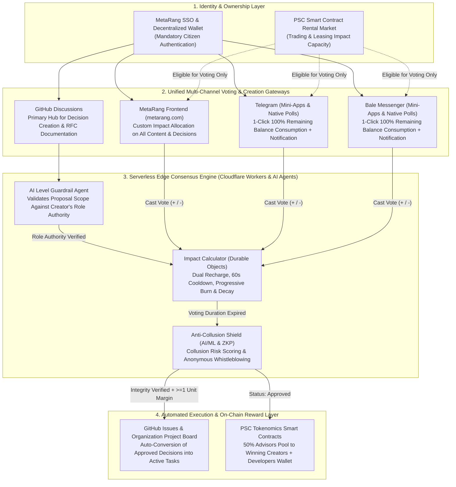

<div align="center">

# 🏛️ Metaverse-Rang-Public-Decision-DAO
### Decentralized Governance (DAO) Infrastructure, "Had-e-Tasar" Impact Engine (v2), and Public Decision Automation

[](https://github.com/iranpsc/Metaverse-Rang-Public-Decision-DAO)
[](https://github.com/iranpsc/Metaverse-Rang-Public-Decision-DAO/discussions)
[](https://workers.cloudflare.com/)
[](#4-psc-tokenomics-integration--automated-reward-distribution)
[](#5-three-layer-anti-collusion-shield--zkp-privacy)
[](./LICENSE)

**Bridging Multi-Channel Citizen Consensus Across the Metaverse & Messengers with Automated Open-Source Execution on GitHub**

[Explore Discussions (Create Decisions)](https://github.com/iranpsc/Metaverse-Rang-Public-Decision-DAO/discussions) • [Explore Issues (Approved Tasks)](https://github.com/iranpsc/Metaverse-Rang-Public-Decision-DAO/issues) • [MetaRang Platform](https://metarang.com)

</div>

---

## 1. Overview & Strategic Vision

The **`Metaverse-Rang-Public-Decision-DAO`** repository serves as the core decentralized governance and Creator Economy infrastructure for the **MetaRang** parallel metaverse ecosystem[cite: 1]. It replaces traditional hierarchical management with a dynamic, meritocratic, and agentic governance protocol powered by **"Had-e-Tasar" (Impact Limit)**—a consumable and rechargeable digital credit unit assigned to every citizen to measure real-time influence and participation[cite: 1].

### Core Objectives of Version 2.0:
* **100% Decentralized Open-Source Governance:** Enacting foundational laws, approving executive charters, prioritizing technical development backlogs, ranking educational content, and validating 3D digital assets exclusively through citizen voting[cite: 1].
* **Off-Git Consensus, On-Git Automated Execution:** Aggregating citizen votes across all ecosystem touchpoints (the MetaRang frontend, Telegram Mini-Apps/Polls, and Bale Mini-Apps/Polls) and automatically converting approved proposals from `GitHub Discussions` into actionable `GitHub Issues` on the organization's project boards.
* **Law of Exponential Progression:** Dynamically scaling quorum thresholds, voting durations, anti-inflationary Burn Numbers[cite: 1], impact multipliers[cite: 1], and creator lock penalties across a 13-tier governance hierarchy[cite: 1].
* **Algorithmic PSC Tokenomics Integration:** Automatically distributing on-chain rewards to victorious decision creators and open-source developers from the annual PSC treasury release under the "Exponential Decay and Eternal Sustainability" protocol[cite: 2, 3].

---

## 2. Ecosystem Architecture & Cross-Platform Integrations

This repository acts as the decentralized orchestration layer connecting six core components of the MetaRang infrastructure via Cloudflare Workers, Durable Objects, and EVM Smart Contracts:



### Connected Repositories & Microservices (`iranpsc`)

| Connected Service / Repository | Protocol / Interface | Role in the Public Decision DAO Lifecycle |
| :--- | :---: | :--- |
| **`SSO-Paradise-Supply-Chain-Go`** | `OAuth2 / JWT / Web3` | Verifies citizen identity, role level (1–13)[cite: 1], and 100% intrinsic ownership of Impact Limit prior to decision creation or voting. |
| **`Metaverse-Rang-Front-NextJS`** | `REST / WebSocket` | Primary web interface enabling granular (custom amount) Impact Limit voting across all platform content, forums, tutorials, 3D assets, and governance proposals[cite: 1]. |
| **`Metaverse-Rang-Microservice`** | `gRPC / Webhook` | Hosts the `public-decision/register` endpoint, the `Public Decision System` module, and the `Reward & Distribution Service`[cite: 1]. |
| **Telegram & Bale Bots / Mini-Apps** | `Cloudflare Worker Webhook` | Broadcasts active decisions to community groups/channels, executes the "1-Click 100% Remaining Balance" voting rule, and dispatches instant consumption notifications. |
| **`Metaverse-Rang-PSC-Governance-Coin`** | `EVM Smart Contracts` | Executes the Impact Limit rental marketplace[cite: 1], the 10% exponential decay PSC treasury[cite: 2], and automated payouts to decision creators and `Developers Wallet`[cite: 2, 3]. |
| **`3DMeta-Shop-Object-3D` & Core Repos** | `GitHub App / GraphQL API` | Receives automated `GitHub Issues` and project board cards immediately upon approval of technical or asset-validation decisions[cite: 1]. |

---

## 3. Core Governance Mechanics & The Law of Progression (Charter v2)

### A. Decision Creation Rules & Full Intrinsic Staking
1. **100% Intrinsic Ownership Requirement:** To create a new public decision, a citizen must hold 100% of their role's intrinsic Impact Limit capacity unspent and unleased.
2. **Rental Market Restrictions:** Citizens can buy, sell, or lease Impact Limit capacity (temporarily or for specific sections such as forums or the metaverse) via smart contracts and PSC tokens[cite: 1]. However, **leased Impact Limit can only be used to vote on existing decisions**; creating a decision strictly requires intrinsic role ownership.
3. **Full Collateral Lock & Creator Voting Ban:** Upon creating a decision, 100% of the creator's Impact Limit is locked as collateral until the voting period concludes. During this lock period, the creator cannot initiate another decision and **is strictly prohibited from voting on any decision (including their own)**.
4. **Irrevocability:** Once a decision is registered and Impact Limit is staked, the creator cannot cancel, withdraw, or prematurely close the decision.
5. **Vertical Authority Boundaries & AI Semantic Guardrail:** A citizen may only create decisions governing the features, rules, and needs of **their own role level and lower citizen tiers**. Lower tiers cannot enact rules for higher governance tiers. Before a `GitHub Discussion` is published, the Cloudflare AI Agent (`ai-level-guardrail`) semantically analyzes the proposal; if its scope exceeds the creator's tier authority, registration is automatically blocked and the required governance tier is reported to the user.

### B. The 13 Governance Tiers, Capacities, Quorums & Voting Durations
A citizen's Impact Limit capacity defines their role and authority within the MetaRang governance hierarchy[cite: 1]. Following the **Law of Exponential Progression**, the intrinsic capacity, allowed decision scope, minimum participation quorum, and voting window for each of the 13 roles are enforced as follows:

| Tier ($L$) | Governance Role[cite: 1] | Intrinsic Impact Capacity ($I_L$)[cite: 1] | Allowed Creation Scope | Progressive Quorum (Total Impact) | Voting Duration | Scope of Authority & Responsibilities[cite: 1] |
| :---: | :--- | :---: | :---: | :---: | :---: | :--- |
| **1** | **Citizen** (`شهروند`)[cite: 1] | `1`[cite: 1] | Tier 1 | `100` units | 24 Hours | Baseline credit level; general participation in voting and micro-level community building[cite: 1]. |
| **2** | **Reporter** (`خبرنگار`)[cite: 1] | `3`[cite: 1] | Tiers 1–2 | `300` units | 36 Hours | Limited reporting and initial influence in community decision-making[cite: 1]. |
| **3** | **Contributor** (`مشارکت‌کننده`)[cite: 1] | `8`[cite: 1] | Tiers 1–3 | `800` units | 48 Hours (2d) | Active participation in social and community decisions; interactive role without final policymaking power[cite: 1]. |
| **4** | **Developer** (`توسعه‌دهنده`)[cite: 1] | `18`[cite: 1] | Tiers 1–4 | `1,800` units | 72 Hours (3d) | Technical weight in system growth and direct influence over infrastructure layers[cite: 1]. |
| **5** | **Inspector** (`بازرس`)[cite: 1] | `36`[cite: 1] | Tiers 1–5 | `3,600` units | 96 Hours (4d) | Supervisory control role with substantial weight in technical and systemic validations[cite: 1]. |
| **6** | **Merchant** (`تاجر`)[cite: 1] | `76`[cite: 1] | Tiers 1–6 | `7,600` units | 120 Hours (5d) | Medium-to-high influence across commercial and economic cycles[cite: 1]. |
| **7** | **Advocate** (`دادخواه`)[cite: 1] | `166`[cite: 1] | Tiers 1–7 | `16,600` units | 144 Hours (6d) | Legal representative with strong influence in processes, protecting citizen rights, and dispute resolution[cite: 1]. |
| **8** | **City Council** (`شورای شهر`)[cite: 1] | `366`[cite: 1] | Tiers 1–8 | `36,600` units | 168 Hours (7d) | Local policymaking tier with high voting weight, aggregating citizen views and submitting constructive proposals[cite: 1]. |
| **9** | **Mayor** (`شهردار`)[cite: 1] | `796`[cite: 1] | Tiers 1–9 | `79,600` units | 192 Hours (8d) | Executive authority empowered to approve land subdivision and consolidation[cite: 1]. |
| **10** | **Governor** (`فرماندار`)[cite: 1] | `1,696`[cite: 1] | Tiers 1–10 | `169,600` units | 216 Hours (9d) | Regional governance tier with very high influence, overseeing balanced provincial development[cite: 1]. |
| **11** | **Commissioner** (`کارگزار`)[cite: 1] | `3,696`[cite: 1] | Tiers 1–11 | `369,600` units | 240 Hours (10d) | Macro-policymaking, community development leadership, and granting loans from governance funds[cite: 1]. |
| **12** | **Arbitrator** (`داور`)[cite: 1] | `7,896`[cite: 1] | Tiers 1–12 | `789,600` units | 288 Hours (12d) | Official judicial authority with structural influence and a vital role in resolving disputes based on laws[cite: 1]. |
| **13** | **Legislator** (`دادگذار`)[cite: 1] | `16,369`[cite: 1] | All Tiers (1–13) | `1,636,900` units | 336 Hours (14d) | Highest credit tier; unmatched role in drafting, interpreting, and shaping social structures and foundational laws[cite: 1]. |

### C. Mathematical Voting Mechanics, Dual Recharge & Progressive Modifiers

* **Positive & Negative Impact Consumption:** Citizens spend Impact Limit to increase (positive vote) or decrease (negative vote) the score of a decision, response, or content item (e.g., 30 positive units minus 10 negative units results in a net impact of 20 units)[cite: 1].
* **Single-Unit Margin Rule (Absolute Majority at Expiration):** Final tallying occurs at the exact second the decision's voting duration expires. Provided the total participation quorum is met, **even a 1-unit margin determines the final outcome**:
  * If a decision receives `50,001` negative units and `49,999` positive units (or differs by just `1` unit in a multi-million-unit vote), a net negative margin of `1` unit results in `Rejected`, whereas a net positive margin of `1` unit results in `Approved`[cite: 1].
* **Progressive Burn & Impact Decay (Higher Tiers Voting on Lower-Tier Decisions):** While voting is open to all authenticated citizens, to prevent high-capacity roles from overwhelming lower-tier community decisions, whenever a citizen of tier $L_v$ votes on a decision belonging to a lower tier $L_d$ ($L_v > L_d$), an anti-inflationary **Burn Number** (permanently removing a portion of spent impact from the cycle)[cite: 1] and a **Decay Multiplier**[cite: 1] are applied exponentially for each tier of difference ($\Delta L = L_v - L_d$):

$$\Delta L = L_v - L_d \quad , \quad \text{Burn}_{\text{progressive}} = \text{RawVote} \times \left(1 - (0.85)^{\Delta L}\right) \quad , \quad \text{EffectiveVote} = \frac{\text{RawVote} - \text{Burn}_{\text{progressive}}}{2^{\lfloor \Delta L / 2 \rfloor}}$$

* **60-Second Cooldown & Minimum Unit Floor:** After each impact consumption, a mandatory 60-second cooldown is enforced before the user can vote again, and no impact transaction below `1` unit is permitted[cite: 1].
* **Dual Recharge Mechanism for Voters:** Impact Limit is a renewable resource that prevents power monopolies through two recharge modes[cite: 1]:
  1. *Gradual Recharge (Partial Consumption):* If only part of a citizen's capacity is spent, the consumed amount recharges proportionally over the remaining time of the 24-hour cycle (e.g., spending 10 of 20 units restores fully in 12 hours)[cite: 1].
  2. *Instant Per-Minute Recharge (Full Consumption):* If 100% of a citizen's capacity is spent, recharge begins immediately on a per-minute basis (e.g., spending 1,440 units restores 1 unit per minute starting immediately)[cite: 1].
* **Creator Collateral Unlock & Progressive Failure Penalty:**
  * *If Approved:* Once the voting period ends in victory, the creator's staked Impact Limit enters the recharge cycle and becomes 100% available after **24 hours**.
  * *If Rejected:* To deter spam and low-quality proposals, the creator's recharge lock duration increases exponentially based on consecutive failed proposals ($N_{\text{failed}}$) and the negative-to-positive vote ratio:

$$T_{\text{unlock}} = 24 \text{ hours} \times 2^{N_{\text{failed}}} \times \left(1 + \frac{V_{\text{negative}}}{V_{\text{positive}} + 1}\right)$$

* **Unified Multi-Channel Voting Rules:**
  * **Mandatory SSO / Wallet Authentication:** Only users with an active connection to a **MetaRang SSO account or decentralized Wallet** can vote. Unconnected guest voting is disabled.
  * **1-Click 100% Consumption on Telegram & Bale:** Clicking a vote button in Telegram or Bale channels/groups **consumes 100% of the citizen's remaining available Impact Limit in a single click**, immediately triggering a notification displaying the exact amount spent. Citizens who wish to spend a custom partial amount must vote via the **MetaRang Frontend (`metarang.com`)**.
  * **Transparent History & Aggregation:** All impact transactions are publicly logged with user identity, timestamp, and impact value, while consecutive votes by the same user on the same topic are automatically aggregated into a single net entry (e.g., +5 followed by -10 is displayed as `-5 units`)[cite: 1].

---

## 4. PSC Tokenomics Integration & Automated Reward Distribution

This governance engine is natively bound to the **PSC Tokenomics Executive Charter** (Official Launch: `1406/08/15` Solar Hijri / `2027`), which has a Total Supply of `200,000,000 PSC` governed by the **"Exponential Decay and Eternal Sustainability"** algorithm[cite: 2]. Every year, exactly **10% of the remaining treasury balance** is released, ensuring the treasury is never depleted while annual issuance becomes progressively scarcer[cite: 2].

### A. Winning Decision Creators Reward Pool (50% of Advisors Allocation)
Under the PSC Tokenomics algorithm, 1% of the remaining treasury balance (equal to **10% of the total annual released tokens**) is allocated to Scientific Advisors[cite: 2]. Because citizen decisions drive ecosystem sustainability and growth, **half of the Advisors' annual allocation (50% of the Advisors' share, or 5% of all tokens released annually)** is dedicated to **Winning Decision Creators (`Approved` status)** and distributed proportionally based on the **net positive votes ($V^+$) earned** by each approved decision:

$$\text{Creators Annual Pool} = 0.50 \times \text{Advisors Annual Allocation} = 0.05 \times \text{Annual Released PSC}$$

$$R_i = \text{Creators Annual Pool} \times \left( \frac{V_i^+}{\sum_{k=1}^{m} V_k^+} \right)$$

### B. 3-Year PSC Release & DAO Governance Reward Simulation

| Network Year | Remaining Treasury Balance[cite: 2] | Annual Release (10% of Treasury)[cite: 2] | Total Advisors Share (10% of Release)[cite: 2] | Winning Decision Creators Pool (50% of Advisors) | Core Developers Share (10% of Release)[cite: 2] |
| :--- | :---: | :---: | :---: | :---: | :---: |
| **Year 1 (`1406`)**[cite: 2] | `180,000,000 PSC`[cite: 2] | `20,000,000 PSC`[cite: 2] | `2,000,000 PSC`[cite: 2] | **`1,000,000 PSC`** | `2,000,000 PSC` (Phase 1 Isolated Security Protocol)[cite: 2, 3] |
| **Year 2 (`1407`)**[cite: 2] | `162,000,000 PSC`[cite: 2] | `18,000,000 PSC`[cite: 2] | `1,800,000 PSC`[cite: 2] | **`900,000 PSC`** | `1,800,000 PSC` (Automated `Developers Wallet`)[cite: 2, 3] |
| **Year 3 (`1408`)**[cite: 2] | `145,800,000 PSC`[cite: 2] | `16,200,000 PSC`[cite: 2] | `1,620,000 PSC`[cite: 2] | **`810,000 PSC`** | `1,620,000 PSC` (Automated `Developers Wallet`)[cite: 2] |

* **Developer Wallet Automation (Phase 1 vs. Phase 2):** In Year 1, developer Ethereum wallets are generated and encrypted under the Phase 1 isolated security protocol by Founder & CEO Hossein Ghadiri and supervised by Lead Blockchain Engineer Parsa Abolhasani[cite: 3]. From Year 2 (`1407`) onward, manual wallet creation ceases, and the entire annual developer allocation is deposited directly into the fixed `Developers Wallet` smart contract for automated distribution based on performance, efficiency metrics, and completed DAO governance tasks[cite: 3].
* **Domain-Specific Reward Triggers:** Upon final approval of commercial or municipal decisions (such as virtual real estate acquisitions), the `Reward & Distribution Service` automatically distributes domain rewards among participating voters (for example, distributing 50% of the property value plus 2x generated profit among voting Mayors)[cite: 1].

---

## 5. Three-Layer Anti-Collusion Shield & ZKP Privacy

To protect decentralized governance from organized manipulation, Sybil rings, and vote-buying, the `anti-collusion-agent` enforces a three-layer security architecture before any decision can transition to `Approved`[cite: 1]:

1. **Layer 1 — Behavioral & Network Indicators:**
   * *Behavioral Signals:* Real-time tracking of synchronized group voting within short windows, sudden last-minute impact spikes prior to expiration, abnormal 100% capacity dumps on low-importance decisions, and single-purpose voting accounts lacking organic participation[cite: 1].
   * *Network Signals:* Detection of silent voting clusters, Sybil attacks (correlated IP ranges and registration timestamps), and suspicious PSC token transfers immediately preceding coordinated votes[cite: 1].
2. **Layer 2 — AI/ML Detection Engine & Smart Contract Rules:**
   * Real-time graph analysis computing a dynamic **Collusion Risk Score** for every participant[cite: 1].
   * 24/7 **Agentic AI** monitoring transaction histories for early flagging and automated enforcement[cite: 1].
   * Smart contract guards that automatically flag any decision receiving more than a threshold $X\%$ of its total impact from newly created accounts[cite: 1].
3. **Layer 3 — Graduated Response System & Zero-Knowledge Proofs (ZKP):**
   * *Alert Level 1 (Low Risk):* Logged silently for continuous AI model training[cite: 1].
   * *Alert Level 2 (Investigation):* Pauses automated GitHub execution and escalates the case to a technical supervisor or **Inspector (`36` units)**[cite: 1].
   * *Alert Level 3 (Governance Action):* Applies temporary voting multiplier reductions (e.g., halving voting power), suspends offending accounts, or invalidates compromised votes[cite: 1].
   * *ZKP Whistleblower Protection & Right to Appeal:* Citizens can report collusion anonymously using **Zero-Knowledge Proofs (ZKP)** to guarantee complete whistleblower privacy, while all penalized users retain a formal right to appeal and judicial review[cite: 1].

---

## 6. Repository Architecture & Deployment Guide

```text
Metaverse-Rang-Public-Decision-DAO/
├── .github/
│   ├── workflows/
│   │   ├── discussion-to-issue-sync.yml   # Converts Approved Discussions into Issues & Project Cards
│   │   └── cloudflare-edge-deploy.yml     # CI/CD pipeline for Cloudflare Workers & Durable Objects
│   └── DISCUSSION_TEMPLATE/
│       └── public-decision-proposal.yml   # Standardized YAML schema for creating new decisions
├── docs/
│   ├── EXECUTIVE_CHARTER_V2.md            # Full Had-e-Tasar v2 Governance Specification
│   └── PSC_TOKENOMICS_SPEC.md             # Exponential Decay Tokenomics & Treasury Protocol
├── workers/
│   ├── orchestrator-agent/                # Unified API gateway for GitHub, MetaRang, Telegram & Bale
│   ├── impact-calculator-do/              # Durable Object for Dual Recharge, 60s Cooldown & Burn math
│   ├── ai-level-guardrail/                # Workers AI agent enforcing role-tier authority boundaries
│   └── anti-collusion-agent/              # AI/ML Collusion Risk Score engine & Sybil detector
├── contracts/
│   ├── PSCExponentialTreasury.sol         # 10% annual release & 50% Advisors-to-Creators reward pool
│   ├── ImpactRentalMarket.sol             # Smart contract for leasing Impact Limit capacity via PSC
│   └── ZKPWhistleblower.sol               # Zero-Knowledge Proof circuit for anonymous abuse reporting
├── schemas/
│   └── decision-payload.schema.json       # JSON Schema for public-decision/register payloads
├── wrangler.toml                          # Cloudflare Edge & Durable Objects configuration
├── package.json
└── README.md
```

### Quick Start & Edge Deployment

```bash
# 1. Clone the repository
git clone [https://github.com/iranpsc/Metaverse-Rang-Public-Decision-DAO.git](https://github.com/iranpsc/Metaverse-Rang-Public-Decision-DAO.git)
cd Metaverse-Rang-Public-Decision-DAO

# 2. Install dependencies
npm install

# 3. Configure encrypted Cloudflare Worker secrets
npx wrangler secret put GITHUB_APP_PRIVATE_KEY
npx wrangler secret put METARANG_SSO_PUBLIC_KEY
npx wrangler secret put TELEGRAM_BOT_TOKEN
npx wrangler secret put BALE_BOT_TOKEN
npx wrangler secret put PSC_TREASURY_CONTRACT_ADDRESS

# 4. Run unit & mathematical simulation tests (Single-Unit Margin, Progressive Burn, Dual Recharge)
npm run test

# 5. Deploy agents and Durable Objects to the Cloudflare Edge network
npx wrangler deploy
```

---

## 7. Open Research RFCs & Community Contribution

All modifications to this repository are governed by the Had-e-Tasar v2 protocol itself:
* **Open Research Topic (`RFC-001: Upward Escalation`):** While citizens of lower tiers cannot directly create decisions for higher tiers, the community is actively evaluating an **Upward Escalation Mechanism**—whereby a lower-tier decision achieving extraordinary exponential support (e.g., $10\times$ its tier quorum) is automatically elevated as a "Ready-to-Stake Draft" for higher-tier role holders. Join the debate in the [Discussions](https://github.com/iranpsc/Metaverse-Rang-Public-Decision-DAO/discussions) tab.
* To submit a new decision or code contribution, ensure your account is linked to **MetaRang SSO / Decentralized Wallet** with 100% unspent intrinsic Impact Limit capacity[cite: 1].

---

<div align="center">
<sub><b>Paradise Supply Chain Cooperative (شرکت تعاونی زنجیره تأمین بهشت) • MetaRang Ecosystem (`iranpsc`)</b><br>
Released under the MIT License — Powered by Had-e-Tasar Algorithm v2[cite: 1] & PSC Exponential Tokenomics[cite: 2, 3]</sub>
</div>
