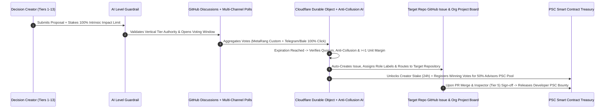

<div align="center">

# 🔄 Executive Delegation & Automated Routing Charter (v2.0)
### Transparent Task Handoff, Role Accountability, and PSC Reward Settlement Protocol

[](https://github.com/iranpsc/Metaverse-Rang-Public-Decision-DAO)
[](https://workers.cloudflare.com/)
[](../README.md)

</div>

---

## 1. Purpose of This Charter

In a fully decentralized organization, passing a vote is only half of governance; **transparent execution and verifiable delegation** form the other half. This document defines the deterministic routing rules executed by our Cloudflare Edge Agents and GitHub Actions the exact second a public decision transitions from `GitHub Discussions` to `Approved` status.

---

## 2. Deterministic 5-Stage Lifecycle of a Decision

Every decision created in the MetaRang ecosystem follows an immutable, auditable trail across five stages:



---

## 3. Automated Repository & Role Delegation Matrix

When a Discussion reaches `Approved` status, the `github-bridge-agent` reads the `target_repository` and `target_tier` metadata from the Discussion form and automatically delegates execution, inspection, and sign-off according to the following matrix:

| Target Domain / Repository | Minimum Creation Tier | Assigned Execution Role | Mandatory Sign-Off / Audit Role | Reward & Settlement Source |
| :--- | :---: | :---: | :---: | :--- |
| **`Metaverse-Rang-Public-Decision-DAO`**<br>*(Foundational Laws & Charters)* | **Tier 13: Legislator** (`16,369`)<br>or **Tier 12: Arbitrator** (`7,896`) | Automated Git Merge Agent | **Tier 12: Arbitrator** (`7,896`)[cite: 1]<br>& **Tier 13: Legislator** (`16,369`)[cite: 1] | **Creators Pool:** 50% of PSC Advisors Allocation[cite: 2] |
| **`Metaverse-Rang-PSC-Governance-Coin`**<br>*(Smart Contracts & Financial Rules)* | **Tier 11: Commissioner** (`3,696`)[cite: 1]<br>or **Tier 6: Merchant** (`76`)[cite: 1] | **Tier 4: Developer** (`18`)[cite: 1]<br>*(Blockchain Security Team)*[cite: 3] | **Tier 5: Inspector** (`36`)[cite: 1]<br>& **Tier 11: Commissioner** (`3,696`)[cite: 1] | **Creators Pool** + **Developers Wallet** (10% Annual Release)[cite: 2, 3] |
| **`Metaverse-Rang-Geographical-Maps`**<br>*(Land Subdivision & Regional Maps)* | **Tier 10: Governor** (`1,696`)[cite: 1]<br>or **Tier 9: Mayor** (`796`)[cite: 1] | **Tier 9: Mayor** (`796`)[cite: 1]<br>& GIS/Map Developers | **Tier 10: Governor** (`1,696`)[cite: 1]<br>& **Tier 5: Inspector** (`36`)[cite: 1] | **Municipal Reward Service** (e.g., 50% property fee + 2x profit to voting Mayors)[cite: 1] |
| **`Metaverse-Rang-Front-NextJS`**<br>*(Citizen Portal & UI/UX)* | **Tier 1: Citizen** (`1`) to **Tier 4: Developer** (`18`)[cite: 1] | **Tier 4: Developer** (`18`)[cite: 1]<br>*(Frontend Engineering)* | **Tier 5: Inspector** (`36`)[cite: 1] | **Creators Pool** + **Developers Wallet**[cite: 2, 3] |
| **`Metaverse-Rang-Microservice`**<br>*(Go Backend & gRPC Services)* | **Tier 4: Developer** (`18`)[cite: 1] | **Tier 4: Developer** (`18`)[cite: 1]<br>*(Backend/DevOps Team)* | **Tier 5: Inspector** (`36`)[cite: 1] | **Creators Pool** + **Developers Wallet**[cite: 2, 3] |
| **`Metaverse-Rang-World-3D-Multiverse`**<br>*(Unity 6 Engine & WebGL Core)* | **Tier 3: Contributor** (`8`) to **Tier 4: Developer** (`18`)[cite: 1] | **Tier 4: Developer** (`18`)[cite: 1]<br>*(3D Engine Specialists)* | **Tier 5: Inspector** (`36`)[cite: 1] | **Creators Pool** + **Developers Wallet**[cite: 2, 3] |
| **`3DMeta-Shop-Object-3D`**<br>*(3D Models & Digital Assets)*[cite: 1] | **Tier 3: Contributor** (`8`)[cite: 1] | 3D Asset Creators / **Tier 4: Developer** (`18`)[cite: 1] | **Tier 5: Inspector** (`36`)[cite: 1] | **Creators Pool** + Asset Validation Rewards[cite: 1, 2] |
| **`SSO-Paradise-Supply-Chain-Go`**<br>*(Identity, Citizen Rights & Privacy)* | **Tier 7: Advocate** (`166`)[cite: 1]<br>or **Tier 4: Developer** (`18`)[cite: 1] | **Tier 4: Developer** (`18`)[cite: 1] | **Tier 7: Advocate** (`166`)[cite: 1]<br>& **Tier 5: Inspector** (`36`)[cite: 1] | **Creators Pool** + **Developers Wallet**[cite: 2, 3] |

---

## 4. Transparent State Transitions & GitHub Labels

Every decision and delegated task is tracked across the `iranpsc` organization using standardized, machine-readable labels applied exclusively by the DAO automation agents:

| Label | Stage | Meaning & System Action |
| :--- | :---: | :--- |
| `status: pending-ai-guard` | Stage 1 | Proposal submitted; awaiting semantic check of creator's vertical tier authority. |
| `status: active-voting` | Stage 2 | 100% of creator's intrinsic Impact Limit is staked; voting is live on MetaRang, Telegram, and Bale. |
| `status: under-collusion-audit` | Stage 3 | Voting window closed; `anti-collusion-agent` is verifying Collusion Risk Score and Sybil indicators[cite: 1]. |
| `status: approved-delegated` | Stage 4 | Quorum met with $\ge 1$ unit positive margin; converted to a `GitHub Issue` in the target repository[cite: 1]. |
| `status: rejected-penalized` | Stage 4 | Failed quorum or negative margin $\ge 1$ unit; Discussion closed and Progressive Lock Penalty applied to creator. |
| `status: completed-settled` | Stage 5 | Resulting Pull Request merged and verified by **Inspector (`36` units)**[cite: 1]; PSC rewards settled on-chain[cite: 2, 3]. |

---

## 5. Immutable Audit Trail Record (JSON Receipt)

Whenever a decision transitions from a Discussion to an actionable Issue, the orchestrator agent appends a cryptographic audit receipt to both the source Discussion and the delegated Issue:

```json
{
  "delegation_receipt_version": "2.0.0",
  "decision_id": "DEC-2026-0001",
  "source_discussion_url": "[https://github.com/iranpsc/Metaverse-Rang-Public-Decision-DAO/discussions/1](https://github.com/iranpsc/Metaverse-Rang-Public-Decision-DAO/discussions/1)",
  "delegated_issue_url": "[https://github.com/iranpsc/Metaverse-Rang-Front-NextJS/issues/105](https://github.com/iranpsc/Metaverse-Rang-Front-NextJS/issues/105)",
  "creator_audit": {
    "citizen_id": "hm-2000001",
    "role_tier": 4,
    "staked_impact_locked": 18,
    "unlock_scheduled_at": "2026-10-22T12:00:00Z"
  },
  "tally_summary": {
    "required_quorum": 1800,
    "total_effective_participation": 4250.5,
    "effective_positive_votes": 2126.0,
    "effective_negative_votes": 2124.5,
    "total_burned_impact": 312.4,
    "net_margin": "+1.5",
    "single_unit_margin_verified": true,
    "collusion_risk_score": 0.04,
    "final_status": "APPROVED"
  },
  "reward_settlement": {
    "creator_pool_source": "50_PERCENT_PSC_ADVISORS_ALLOCATION",
    "eligible_positive_weight": 2126.0,
    "developer_bounty_wallet": "Developers_Wallet_Automated_Pool"
  }
}
```

---

<div align="center">
<sub><b>MetaRang Decentralized Governance (`iranpsc`)</b> • Automated Delegation & Transparent Accountability Protocol</sub>
</div>
